# PIOS Entity Relationship Diagram

Status: Draft  
Updated: 2026-06-06  
Stack target: Laravel 13, FilamentPHP 5, MySQL  
Source of truth: `PIOS_PRD.md`

## Scope

This ERD models the current v1 direction:

- PIOS Owner / System users register Partners.
- Partners register Business Owners.
- Business Owners own contacts, prospects, customers, product selections, product proposals, promotions, fees, and sales activity.
- Products are globally managed, then selected by Business Owners.
- Customer/product eligibility is enforced server-side through Laravel policies and query scopes.

Open PRD questions still affect final migrations: Partner tier thresholds, LOS MSMY verification, VIP RM2 fee, Business Owner monthly fee policy, product proposal approval rules, WhatsApp integration method, and whether Partner-led customer registration remains in scope.

## Core ERD

```mermaid
erDiagram
    USERS ||--o| PARTNERS : login_profile
    USERS ||--o| BUSINESS_OWNERS : login_profile
    USERS ||--o{ AUDIT_LOGS : performs

    PARTNERS ||--o{ PARTNERS : sponsors
    PARTNERS ||--o{ BUSINESS_OWNERS : registers
    PARTNERS ||--o{ CUSTOMERS : reporting_scope
    PARTNERS ||--o{ FEES : related_entity

    BUSINESS_OWNERS ||--o{ CUSTOMERS : owns
    BUSINESS_OWNERS ||--o{ BUSINESS_OWNER_PRODUCT_SELECTIONS : selects
    BUSINESS_OWNERS ||--o{ PRODUCT_PROPOSALS : submits
    BUSINESS_OWNERS ||--o{ FEES : pays
    BUSINESS_OWNERS ||--o{ ORDERS : sells
    BUSINESS_OWNERS ||--o{ PROMOTIONS : sends

    PRODUCTS ||--o{ BUSINESS_OWNER_PRODUCT_SELECTIONS : selected
    PRODUCTS ||--o{ ORDER_ITEMS : sold_as
    PRODUCTS ||--o{ PROMOTIONS : promoted
    TERRITORIES ||--o{ PRODUCTS : coverage
    TERRITORIES ||--o{ PARTNERS : assigned
    TERRITORIES ||--o{ BUSINESS_OWNERS : assigned

    CUSTOMERS ||--o{ ORDERS : places
    CUSTOMERS ||--o{ PROMOTION_RECIPIENTS : receives

    ORDERS ||--o{ ORDER_ITEMS : contains
    ORDERS ||--o{ PAYMENTS : paid_by

    FEES ||--o{ PAYMENTS : settled_by

    PROMOTIONS ||--o{ PROMOTION_RECIPIENTS : targets
    PROMOTION_RECIPIENTS ||--o{ PROMOTION_RESPONSES : has

    USERS {
        bigint id PK
        string name
        string email UK
        string password
        string role
        timestamp email_verified_at
        timestamp created_at
        timestamp updated_at
    }

    PARTNERS {
        bigint id PK
        bigint user_id FK
        bigint parent_partner_id FK
        bigint territory_id FK
        string partner_no UK
        string abo_no
        string diamond_name
        string applicant_name
        string ic_no
        string hp_no
        string email
        text address
        string bandar
        string negeri
        string poskod
        string spouse_name
        string spouse_ic_no
        string spouse_hp_no
        string spouse_email
        string partner_tier
        string status
        bigint created_by FK
        timestamp created_at
        timestamp updated_at
    }

    BUSINESS_OWNERS {
        bigint id PK
        bigint user_id FK
        bigint partner_id FK
        bigint territory_id FK
        string business_owner_no UK
        string applicant_name
        string ic_no
        string hp_no
        string email
        text address
        string bandar
        string negeri
        string poskod
        string spouse_name
        string spouse_ic_no
        string spouse_hp_no
        string spouse_email
        string company_name
        text product_description
        string status
        bigint created_by FK
        timestamp created_at
        timestamp updated_at
    }

    CUSTOMERS {
        bigint id PK
        bigint business_owner_id FK
        bigint partner_id FK
        string customer_no UK
        string vip_customer_no UK
        string category
        string name
        string nick_name
        string hp_no
        string kp_no
        string email
        text address
        string abo_no
        string dd_name
        string dd_hp_no
        string status
        bigint created_by FK
        timestamp created_at
        timestamp updated_at
    }

    PRODUCTS {
        bigint id PK
        bigint territory_id FK
        string product_no UK
        string product_type
        string name
        text description
        decimal selling_price
        string coverage_area
        string certification
        json promotional_content
        json media_assets
        json pricing_structure
        decimal sales_commission
        string status
        bigint created_by FK
        timestamp created_at
        timestamp updated_at
    }

    BUSINESS_OWNER_PRODUCT_SELECTIONS {
        bigint id PK
        bigint business_owner_id FK
        bigint product_id FK
        string status
        timestamp selected_at
        timestamp created_at
        timestamp updated_at
    }

    PRODUCT_PROPOSALS {
        bigint id PK
        bigint business_owner_id FK
        string name
        string area
        decimal partner_price
        decimal customer_price
        string image_video_path
        text description
        string approval_status
        bigint reviewed_by FK
        timestamp reviewed_at
        timestamp created_at
        timestamp updated_at
    }

    TERRITORIES {
        bigint id PK
        string name
        string coverage_area
        string status
        timestamp created_at
        timestamp updated_at
    }

    FEES {
        bigint id PK
        bigint partner_id FK
        bigint business_owner_id FK
        bigint customer_id FK
        string fee_type
        decimal amount
        date due_date
        string status
        timestamp created_at
        timestamp updated_at
    }

    PAYMENTS {
        bigint id PK
        bigint fee_id FK
        bigint order_id FK
        string payment_type
        decimal amount
        string status
        string reference_no
        timestamp paid_at
        timestamp created_at
        timestamp updated_at
    }

    ORDERS {
        bigint id PK
        bigint business_owner_id FK
        bigint customer_id FK
        string order_no UK
        string status
        decimal subtotal
        decimal total
        timestamp ordered_at
        timestamp created_at
        timestamp updated_at
    }

    ORDER_ITEMS {
        bigint id PK
        bigint order_id FK
        bigint product_id FK
        int quantity
        decimal unit_price
        decimal line_total
        timestamp created_at
        timestamp updated_at
    }

    PROMOTIONS {
        bigint id PK
        bigint business_owner_id FK
        bigint product_id FK
        string channel
        string message_template
        string status
        timestamp sent_at
        timestamp created_at
        timestamp updated_at
    }

    PROMOTION_RECIPIENTS {
        bigint id PK
        bigint promotion_id FK
        bigint customer_id FK
        string delivery_status
        timestamp sent_at
        timestamp created_at
        timestamp updated_at
    }

    PROMOTION_RESPONSES {
        bigint id PK
        bigint promotion_recipient_id FK
        string response_status
        text response_text
        timestamp responded_at
        timestamp created_at
        timestamp updated_at
    }

    AUDIT_LOGS {
        bigint id PK
        bigint user_id FK
        string auditable_type
        bigint auditable_id
        string event
        json old_values
        json new_values
        string ip_address
        timestamp created_at
    }
```

## Ownership Rules

| Rule | Implementation Implication |
| --- | --- |
| Partner registers Business Owner | `business_owners.partner_id` is required. |
| Business Owner owns customers | `customers.business_owner_id` is required for v1 customer records. |
| Parent Partner reporting | `customers.partner_id` can be denormalized from `business_owners.partner_id` for reporting, or derived through joins. |
| Product eligibility | `products.product_type` and `customers.category` must be checked before product visibility, checkout, and promotion. |
| Duplicate customer conflict | Add lookup indexes on `customers.hp_no` and `customers.kp_no`; enforce conflicts in application logic because ownership rules may need authorized overrides. |
| Product selection max 5 | Enforce in application logic unless confirmed as a hard DB-level constraint. |

## Suggested MySQL Indexes

| Table | Index |
| --- | --- |
| `users` | unique `email`; index `role` |
| `partners` | unique `partner_no`; index `parent_partner_id`; index `territory_id`; index `partner_tier`; index `status` |
| `business_owners` | unique `business_owner_no`; index `partner_id`; index `territory_id`; index `status` |
| `customers` | unique `customer_no`; unique nullable `vip_customer_no`; index `business_owner_id`; index `partner_id`; index `category`; index `hp_no`; index `kp_no`; index `status` |
| `products` | unique `product_no`; index `product_type`; index `territory_id`; index `status` |
| `business_owner_product_selections` | unique composite `business_owner_id, product_id`; index `status` |
| `product_proposals` | index `business_owner_id`; index `approval_status`; index `reviewed_by` |
| `fees` | index `business_owner_id`; index `partner_id`; index `fee_type`; index `status`; index `due_date` |
| `payments` | index `fee_id`; index `order_id`; index `status`; index `reference_no` |
| `orders` | unique `order_no`; index `business_owner_id`; index `customer_id`; index `status`; index `ordered_at` |
| `promotions` | index `business_owner_id`; index `product_id`; index `channel`; index `status`; index `sent_at` |
| `audit_logs` | index `user_id`; composite `auditable_type, auditable_id`; index `event`; index `created_at` |

## Recommended Enums or Lookup Tables

These can start as string columns or PHP backed enums, then move to lookup tables if admins need to manage them in Filament.

| Concept | Values |
| --- | --- |
| User role | `pios_owner`, `pios_system`, `partner`, `business_owner` |
| Partner tier | `executive`, `staff`, `senior`, `associate`, `principal` |
| Customer category | `lead`, `prospect`, `customer`, `vip_los`, `non_los` |
| Product type | `amway`, `non_amway` |
| Generic status | `active`, `inactive`, `suspended`, `archived` |
| Product proposal status | `draft`, `submitted`, `approved`, `rejected` |
| Fee status | `pending`, `paid`, `overdue`, `waived`, `cancelled` |
| Payment status | `pending`, `successful`, `failed`, `refunded` |
| Promotion channel | `whatsapp_deep_link`, `whatsapp_business_api`, `manual` |
| Promotion response status | `no_response`, `interested`, `not_interested`, `follow_up`, `converted` |

## Migration Notes

- Use Eloquent models with explicit relationships matching this ERD.
- Use Laravel policies and query scopes for hierarchy filtering; do not rely only on Filament UI hiding.
- Store generated business identifiers separately from primary keys:
  - `partners.partner_no`
  - `business_owners.business_owner_no`
  - `customers.customer_no`
  - `customers.vip_customer_no`
  - `products.product_no`
  - `orders.order_no`
- Prefer `decimal(10,2)` for money fields unless pricing needs larger values.
- Use nullable foreign keys only where the relationship is genuinely optional.
- Keep `audit_logs` generic so Partner, Business Owner, Customer, Product, Fee, and admin changes can all be tracked.
